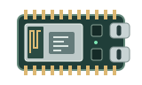

# ESP32 WireLab

面向初学者的 ESP32 可视化接线实验室。在浏览器中摆放主板与外设、连接面包板孔位、查看针脚用途，并通过模拟通电检查接线。



## 能做什么

- 添加多块面包板，并排扩展工作区。
- 搜索并放置常用模块，同类外设支持多个实例。
- 按住板件拖动，已连接的跳线随板件移动。
- 点击两个孔接线，通过颜色追踪同一电气网络。
- 右键查看模块针脚说明，支持浅色、深色与画布缩放。
- 模拟通电后查看模块测试；通电时锁定编辑，断电后恢复。
- 自动保存当前工作台到浏览器本地存储。

目前支持 ESP32-S3 主板，以及 LED、按钮、电位器、BME280、光敏模块、AM312、US-100、SG90、OLED、INMP441、MAX98357A 和喇叭。

## 开始使用

1. 打开部署后的网站，点击右下角“元件”。
2. 选择主板或外设，将鼠标移到孔位预览，点击确认放置。
3. 连续点击两个孔接线；右键板件查看针脚用途。
4. 按 Enter 模拟通电，在右侧选择模块进行测试。
5. 需要改线时先断电。按住板身拖动位置，选中跳线或外设后可按 Delete 删除。

详细操作和常见问题见 [用户指南](docs/USER_GUIDE.md)。

## 本地开发

推荐 Node.js 24，使用 pnpm 8.10.5；版本记录在 `.nvmrc` 和 `package.json`。

```sh
pnpm install --frozen-lockfile
pnpm dev
```

在终端显示的本地地址访问页面。生产构建与本地预览：

```sh
pnpm build
pnpm preview
```

## 模拟范围与数据

这是接线学习工具，使用预设的 GPIO 分配、模块模型和模拟读数，不会烧录或控制真实 ESP32，也不提供真实语音识别、联网对话或电路级仿真。它不会计算电流、功耗、实际时序或所有电气风险。模拟通过不等于实物必然可用。

数据保存在当前浏览器的 `localStorage`，没有账号、云端同步或自动备份。清除站点数据、切换浏览器或更换网站域名后可能无法恢复原工作台。刷新保留布线和电源状态，撤销历史不跨刷新保留。

建议优先用桌面端现代浏览器操作。当前禁用 Tab 焦点遍历，移动端和完整键盘无障碍支持仍有限。

## 项目文档

- [用户指南](docs/USER_GUIDE.md)：操作、快捷键、模拟限制与排错。
- [部署说明](docs/DEPLOYMENT.md)：独立仓库上传、Pages 配置与资源路径。
- [开发与贡献](CONTRIBUTING.md)：代码结构、模块扩展与验证。
- [设计规范](DESIGN.md)：间距、字体、状态和画布几何约束。
- [素材与第三方说明](THIRD_PARTY_NOTICES.md)：依赖、主题动画和音频来源说明。

## 授权

项目尚未选定整体开源许可证，请勿将“仓库公开”理解为已授予任意再分发授权。项目发布者需在发布前确认第三方素材及示例音频的使用权限，详见素材说明。
